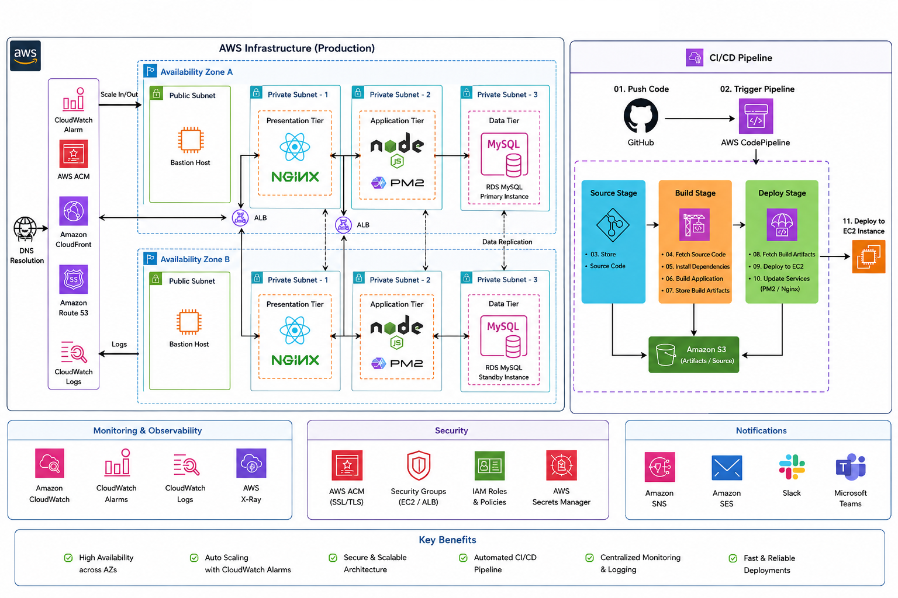
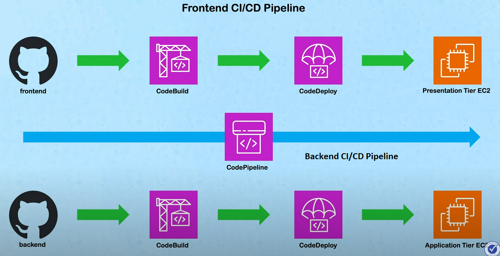
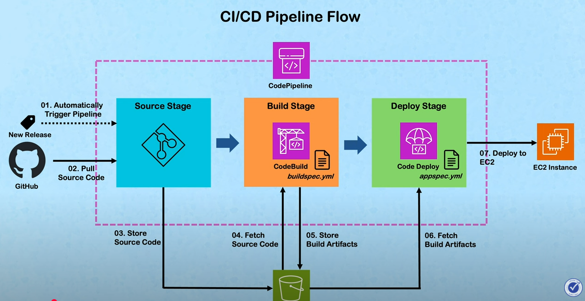
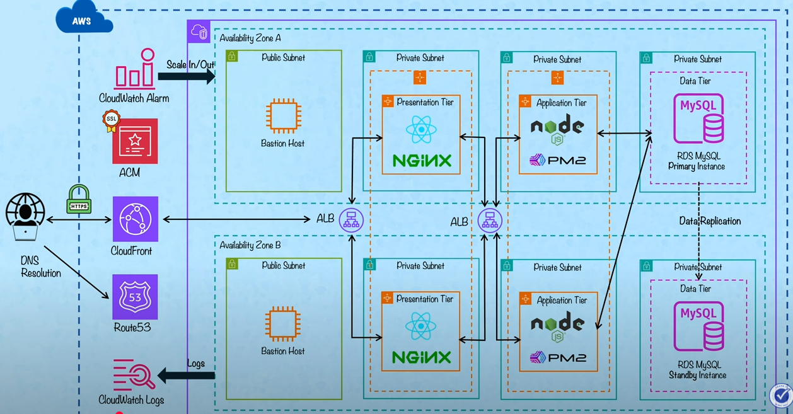

# 3-Tier Web Application on AWS

**A practical reference for deploying a React, Node.js/Express, and MySQL application on AWS with a segmented network architecture and CI/CD.**

This repository collects architecture diagrams, EC2 bootstrap scripts, and deployment notes for a three-tier AWS application. It is intended as a learning and implementation reference.

> **Repository scope:** The application source code, database dump, and CodeBuild/CodeDeploy specification files are not included here. The notes describe a deployment workflow for an application repository that supplies those files; this repository alone is not a deployable application.

## Architecture

The design separates public entry points from application and database resources:

1. **Presentation tier** — an internet-facing Application Load Balancer routes HTTP/HTTPS traffic to NGINX web instances in private subnets. NGINX serves the frontend and proxies API requests.
2. **Application tier** — an internal Application Load Balancer forwards API traffic to Node.js/Express instances in private subnets.
3. **Data tier** — a private Amazon RDS for MySQL instance is reachable only from the application tier.

The deployment notes also cover a VPC, public and private subnets across Availability Zones, security groups, Auto Scaling groups, S3 artifacts, Systems Manager Parameter Store, CloudWatch, and separate CI/CD pipelines for the web and application tiers. Route 53 and CloudFront are listed as optional edge services.

## Application previews

  
  
  

## Repository contents

| File | Description |
| --- | --- |
| [Architecture.png](./Architecture.png) | AWS architecture diagram |
| [architecture1.png](./architecture1.png) | Additional architecture reference |
| [AWS CICD Pipeline - AWS.txt](./AWS%20CICD%20Pipeline%20-%20AWS.txt) | Step-by-step AWS infrastructure and CI/CD notes |
| [web-tier-user-data.txt](./web-tier-user-data.txt) | NGINX, CloudWatch Agent, and CodeDeploy bootstrap example |
| [app-tier-user-data.txt](./app-tier-user-data.txt) | Node.js, PM2, CloudWatch Agent, and CodeDeploy bootstrap example |
| [1.png](./1.png), [2.png](./2.png), [3.png](./3.png) | Application preview images |

## Deployment outline

The detailed walkthrough is in [AWS CICD Pipeline - AWS.txt](./AWS%20CICD%20Pipeline%20-%20AWS.txt). At a high level, the workflow is:

1. Create a VPC, subnets, route tables, and tier-specific security groups.
2. Create the private database and store application settings securely.
3. Configure EC2 launch templates, target groups, load balancers, and Auto Scaling groups.
4. Configure the web and application instances using the supplied user-data examples.
5. Set up separate CodeBuild, CodeDeploy, and CodePipeline workflows for each tier.
6. Add DNS, HTTPS, and optional CloudFront distribution after validating the deployment.

### Prerequisites

- An AWS account with permissions to create and configure the services above.
- An AWS Region with at least two Availability Zones available.
- The application source repository, including its build and deployment specifications.
- A domain name and TLS certificate if you plan to configure public HTTPS.
- Familiarity with VPC networking, IAM, EC2, RDS, and AWS deployment services.

### Before using the examples

- Review every example and replace environment-specific values, including hostnames, domains, ports, Region-specific URLs, and resource names.
- Keep database credentials in **AWS Systems Manager Parameter Store as `SecureString`** or AWS Secrets Manager. Never commit real secrets to source control.
- Restrict security-group rules to the required source security groups and ports. Avoid broad SSH ingress; prefer AWS Systems Manager Session Manager where possible.
- Use least-privilege IAM policies, enable database backups and encryption, and validate health-check paths and deployment settings for your application.
- Treat the bootstrap scripts as starting points: test them in a non-production environment and adapt package commands and service configuration to your chosen Amazon Linux release.

## Learning goals

- Understand separation of presentation, application, and data tiers.
- Practice private-subnet deployment and controlled traffic flow between tiers.
- Explore load balancing, health checks, and horizontal scaling with Auto Scaling.
- Build an AWS CI/CD workflow and centralize logs with CloudWatch.
- Apply safer configuration and secret-management practices.

## Contributions

Improvements to the documentation, diagrams, and deployment examples are welcome. Please keep examples free of account identifiers, credentials, and other environment-specific secrets.
